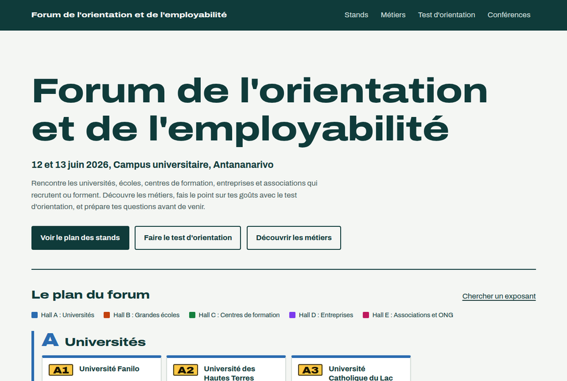
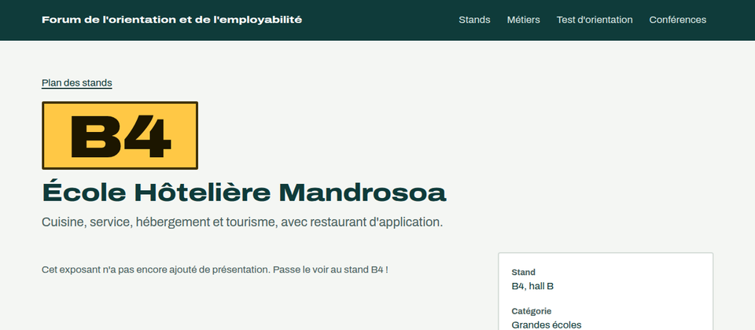
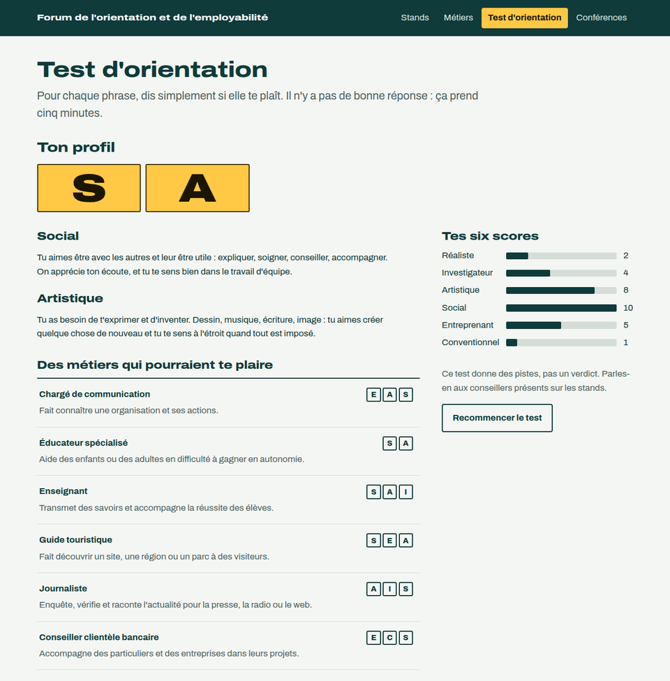

# Forum de l'orientation

Le site d'un forum de l'orientation et de l'employabilité : le plan des stands des exposants
(universités, écoles, centres de formation, entreprises, associations), des fiches métiers et un
test d'orientation qui propose des métiers selon le profil obtenu.



> Réalisé en 2024 pour le forum de l'orientation du Programme SESAME (IECD), à Antananarivo,
> puis refait en 2026 pour ce portfolio. Le contenu du client (logo, photos, textes de son test)
> a été retiré : exposants, métiers et test sont ici fictifs ou réécrits.

## Ce que fait le site

- **Plan des stands** : chaque exposant a un numéro (lettre du hall, place dans l'allée) ; la
  recherche ignore les accents et met en évidence les stands qui correspondent.
- **Fiche d'exposant** : présentation, photos, documents et vidéos ajoutés par les organisateurs.
- **Fiches métiers** : par domaine, avec recherche ; ce qu'on y fait, les études, les qualités.
- **Test d'orientation** en 10 étapes, d'après le modèle RIASEC de Holland : le profil à deux
  lettres, les six scores et des métiers correspondants. Les réponses restent dans le navigateur
  pour reprendre le test plus tard.
- **Conférences** : programme, puis vidéos après le forum.
- **Statistiques anonymes** pour les organisateurs : stands, documents et fiches consultés,
  profils obtenus au test, sans aucune donnée personnelle.




## Architecture

```
web/          Site Vue 3 + Vite (Archivo, CSS maison, aucun framework d'interface)
pocketbase/   Migrations PocketBase : collections, règles d'accès, données d'exemple
```

Le site **ne se connecte jamais** à PocketBase : les règles d'accès des collections autorisent
les visiteurs à lire le contenu public et à créer des statistiques, sans pouvoir les relire.
Les organisateurs gèrent tout depuis le tableau de bord de PocketBase.

| Collection | Visiteurs | Rôle |
|---|---|---|
| `categories`, `exhibitors`, `assets` | lecture | Halls, exposants, photos et documents |
| `domains`, `jobs` | lecture | Fiches métiers et leurs profils RIASEC |
| `talks` | lecture | Conférences |
| `visits`, `test_results` | création seule | Statistiques anonymes |

La limitation de débit de PocketBase est activée contre les envois en masse.

## Lancer le projet

Prérequis : Node.js 20+ et [PocketBase](https://pocketbase.io/docs/) 0.40 (un seul exécutable).

```bash
# 1. PocketBase, avec les collections et les données d'exemple
cd pocketbase
./pocketbase serve            # crée pb_data/ et applique pb_migrations/
# Ouvre http://127.0.0.1:8090/_/ pour créer le compte administrateur.

# 2. Le site, dans un autre terminal
cd web
cp .env.example .env          # VITE_PB_URL : l'adresse de PocketBase
npm install
npm run dev                   # http://localhost:5173
```

Pour la production : `npm run build`, puis servir `web/dist/` (toutes les routes vers
`index.html`) et placer PocketBase derrière HTTPS. Le nom, les dates et le lieu de l'événement
se modifient dans `web/src/data/event.js`.

## Vérifications

```bash
cd web && npm test && npm run lint
```

## Historique

La version de 2024 se connectait à PocketBase en administrateur depuis le navigateur, avec des
identifiants que Vite recopiait dans le JavaScript public. Cette version ne contient plus aucun
identifiant, et les anciens ont été retirés de l'historique du dépôt.

## Crédits

Police Archivo (SIL OFL 1.1). Test d'orientation écrit pour ce projet d'après le modèle RIASEC
de John L. Holland.
